<!-- Generated by scripts/observatory.mjs — edit scripts/content.mjs, not this file. -->

  

  
  

  <a href="https://github.com/search?q=author%3ALingYi-Liang%20type%3Apr&type=pullrequests"></a>

  <a href="https://github.com/langgenius/dify/pull/43537"></a>
  <a href="https://github.com/bytedance/deer-flow/pull/6768"></a>
  <a href="https://github.com/bytedance/deer-flow/pull/6756"></a>
  <a href="https://github.com/bytedance/deer-flow/pull/6476"></a>

  
  <a href="https://github.com/bytedance/deer-flow/pull/6302"></a>
  <a href="https://github.com/Tencent/WeKnora/pull/3973"></a>
  <a href="https://github.com/Tencent/WeKnora/pull/3944"></a>


  
  
  
  
  
  
  
  
  
  
  
  
  
  

  

  

  

✦ <b>AI use disclosure</b> · I may use AI tools to assist my work, including code and pull requests. Everything is carefully reviewed and read by me before it goes out — I make sure I understand it, and I take responsibility for the result.

