<!-- Generated by scripts/observatory.mjs from live GitHub data. Edit scripts/content.mjs, not this file. -->

<b>EN</b> · <a href="https://github.com/LingYi-Liang/LingYi-Liang/blob/main/README.zh-CN.md">中文</a>

**Focus** · Inference serving & KV caching · agent runtimes · RAG & RL frameworks 
**Stack** · Go · Python · C++ · TypeScript · Lean 4 ([machine-checked mathematics](https://github.com/LingYi-Liang/squarefree-fuglede-lean)) 
**Merged upstream** · [30+ pull requests](https://github.com/search?q=author%3ALingYi-Liang%20type%3Apr%20is%3Amerged&type=pullrequests) in open-source projects from [Google](https://github.com/google/adk-python/commits/main?author=LingYi-Liang), [ByteDance](https://github.com/search?q=author%3ALingYi-Liang%20type%3Apr%20is%3Amerged%20repo%3Abytedance%2Fdeer-flow&type=pullrequests), [Tencent](https://github.com/search?q=author%3ALingYi-Liang%20type%3Apr%20is%3Amerged%20repo%3ATencent%2FWeKnora%20repo%3ATencent-Hunyuan%2FUniRL&type=pullrequests), [the vLLM project (AIBrix)](https://github.com/search?q=author%3ALingYi-Liang%20type%3Apr%20is%3Amerged%20repo%3Avllm-project%2Faibrix&type=pullrequests) and others

<b>Open to AI infra roles</b> · <a href="https://lingyi-liang.github.io">lingyi-liang.github.io</a> · <a href="mailto:lingyi01525@gmail.com">lingyi01525@gmail.com</a>

In review at vLLM, SGLang and DeepSeek

 

I use AI tools in my work; every change I submit is reviewed, understood and owned by me.
