<!-- Generated by scripts/observatory.mjs from live GitHub data. Edit scripts/content.mjs, not this file. -->

<a href="https://github.com/LingYi-Liang">EN</a> · <b>中文</b>

**方向** · 推理服务与 KV 缓存 · 智能体运行时 · RAG 与强化学习框架 
**技术栈** · Go · Python · C++ · TypeScript · Lean 4（[机器验证数学](https://github.com/LingYi-Liang/squarefree-fuglede-lean)） 
**已合并进上游** · [20 余个 PR](https://github.com/search?q=author%3ALingYi-Liang%20type%3Apr%20is%3Amerged&type=pullrequests)，涉及 [Google](https://github.com/google/adk-python/commits/main?author=LingYi-Liang)、[字节跳动](https://github.com/search?q=author%3ALingYi-Liang%20type%3Apr%20is%3Amerged%20repo%3Abytedance%2Fdeer-flow&type=pullrequests)、[腾讯](https://github.com/search?q=author%3ALingYi-Liang%20type%3Apr%20is%3Amerged%20repo%3ATencent-Hunyuan%2FUniRL%20repo%3ATencent%2FWeKnora&type=pullrequests)、[vLLM 社区（AIBrix）](https://github.com/search?q=author%3ALingYi-Liang%20type%3Apr%20is%3Amerged%20repo%3Avllm-project%2Faibrix&type=pullrequests)等的开源项目

<b>寻求 AI 基础设施岗位机会</b> · <a href="https://lingyi-liang.github.io">lingyi-liang.github.io</a> · <a href="mailto:lingyi01525@gmail.com">lingyi01525@gmail.com</a>

审核中：vLLM、SGLang、DeepSeek

 

工作中会使用 AI 工具；我提交的每一处改动都经本人审阅、理解，并由本人负责。
