<!-- Generated by scripts/observatory.mjs — edit scripts/content.mjs, not this file. -->

  

  
  

  <a href="https://github.com/search?q=author%3ALingYi-Liang%20type%3Apr&type=pullrequests"></a>

  <a href="https://github.com/langgenius/dify/pull/43537"></a>
  <a href="https://github.com/bytedance/deer-flow/pull/7152"></a>
  <a href="https://github.com/bytedance/deer-flow/pull/6768"></a>
  

  <a href="https://github.com/bytedance/deer-flow/pull/6476"></a>
  <a href="https://github.com/bytedance/deer-flow/pull/6511"></a>
  <a href="https://github.com/bytedance/deer-flow/pull/6302"></a>
  <a href="https://github.com/Tencent/WeKnora/pull/3973"></a>


  
  
  
  
  
  
  
  
  
  
  
  
  
  

  

  

  

✦ <b>AI 使用说明</b> · 我在工作中（包括代码与 PR）可能会使用 AI 辅助，但所有内容都经过本人严格审查和阅读，确认理解后才提交，并由本人对结果负责。

